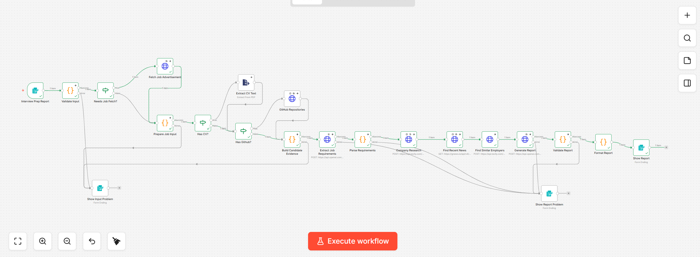
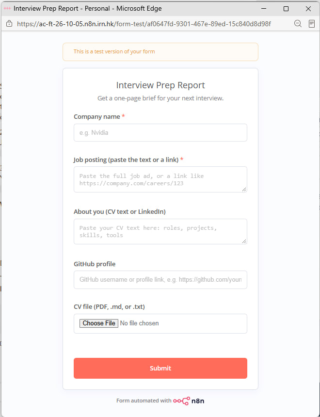
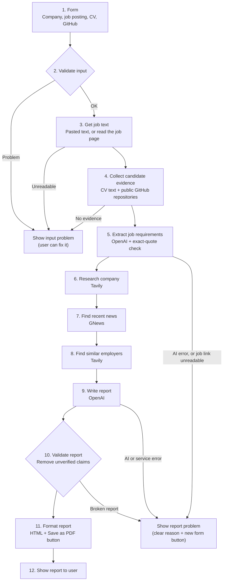

# Interview Prep Report Agent

An n8n workflow that turns a job posting and a candidate's CV into a one-page interview preparation report, with sources for every company fact and evidence for every match.

**Demo video:** [link to recording] *(opens without a login)*
**Author:** Roodabeh Seif · Ironhack AI Consulting, Project 3 · Primary stack: n8n



| The form | An example report |
|---|---|
|  | See [samples/report-2-packmatic.pdf](samples/report-2-packmatic.pdf) |

---

## The problem and the user

**User:** a job seeker with an interview coming up.

**Today:** before an interview, they research the company, read the job ad line by line, and decide which of their own examples to use. This takes hours and is easy to do badly under time pressure.

**With this agent:** they fill in one form, and in about 4 minutes they get a report that tells them what to say about the company, which of their examples match the role, what to prepare, which questions to expect, and which similar employers in Germany they could also approach. The report can be saved as a PDF with one click.

## Product decisions

The main choices behind this MVP, from a product point of view:

1. **Trust is the core value.** A wrong fact in an interview is worse than no fact. Every claim is checked by code before the user sees it, and anything unproven is removed.
2. **Design for the moment of failure.** The user is never left guessing. Every error says what happened, whether it is an input problem or a system problem, and what to do next, with a button back to the form.
3. **Saying no on purpose.** No AI Agent, no vector database and no email delivery in the MVP. Each would add cost, run time or risk without making the report better for this user today. They are listed as next steps.
4. **Test like a user, document honestly.** Testing with real job ads found two failure cases: a typo in the company name leads to the wrong company, and two companies with the same name get mixed up. Both are documented under Known limitations.
5. **Iterate on feedback.** After teacher feedback, the prompt was improved, pasted CV text was accepted, and error pages were added at the start and at the end of the workflow.
6. **Validate before adding features.** The next step is not more features but a usefulness test: 20 real users, with a target of 70% rating the report useful (see [gtm_future_sprints.md](gtm_future_sprints.md)).
7. **Know the unit economics.** About $0.003 of AI cost (estimate) and about 4 minutes per report, instead of hours of manual research.

## What goes in, what comes out

**Input (one web form):**

| Field | Required | Notes |
|---|---|---|
| Company name | Yes | Used for company research and news |
| Job posting | Yes | Paste the full text, or a link to the job ad |
| CV as text | No | Pasted CV or LinkedIn experience |
| GitHub profile | No | Username or profile link |
| CV file | No | PDF, `.md`, or `.txt` |

At least one candidate source (CV text, CV file, or GitHub) is required. If all three are empty, the workflow stops with a clear message.

**Output: a formatted report with 9 sections**

1. **Company background**, with source links
2. **Recent news**: up to 3 recent items, each with a date, link, and why it matters for the interview
3. **Role requirements**: Must-have and Nice-to-have, taken from the job posting
4. **Your match**: each requirement matched to an exact quote from the CV or a real GitHub repository
5. **Projects to highlight**
6. **Skill gaps**, each with one concrete preparation step
7. **Five likely interview questions**: 2 technical, 1 about the company or news, 1 about the biggest gap, 1 behavioural
8. **Ready answers in STAR format**: 1 to 2 answers (Situation, Task, Action, Result) built only from the CV, each showing the CV quote it is based on
9. **Similar employers in Germany**: up to 2 other companies that hire for this kind of role, each with a source link

A **Quality check** note at the end says how many unverified statements were removed and which sources were missing. A **🖨️ Print or save as PDF** button opens the browser's print window, where the user chooses "Save as PDF". The button is hidden in the printed PDF.

---

## Architecture

The workflow runs from the form to the report with no human steps in between.



### Steps in plain words

| Step | What happens |
|---|---|
| 1. Form | The user submits the form. This triggers the workflow. |
| 2. Validate input | Checks required fields, text length, file type, and GitHub username. Splits the job field into a link or pasted text. |
| 3. Get job text | If only a link was given, downloads the page and extracts the job ad. Stops if less than 300 characters can be read. |
| 4. Candidate evidence | Reads the PDF CV, adds pasted text, and loads up to 30 public repositories (forks removed). |
| 5. Requirements | A focused AI step extracts up to 8 requirements. Each must quote the job posting exactly, or it is dropped. |
| 6. Company research | Searches the web for the company plus the team or product named in the job ad. |
| 7. News | Gets the 10 newest English articles about the company. |
| 8. Similar employers | Searches for companies in Germany hiring for the same job title. Job boards (LinkedIn, Indeed, StepStone and others) are excluded, so results are company pages. If this search fails, the report is still created without this section. |
| 9. Write report | The AI writes the report from the checked data only, following strict matching rules. |
| 10. Validate report | Deterministic code removes every claim it cannot trace to a source. |
| 11. Format report | Turns the checked report into a styled page with tags, quotes, source links, and a Save as PDF button. All text is escaped, and only http(s) links are allowed. |
| 12. Show report | The report appears in the form window. |

---

## Grounding and quality checks

This MVP does not use a vector database. Instead, every statement is grounded by code checks after the AI writes:

| Check | Rule | If it fails |
|---|---|---|
| Requirements | Must quote the job posting exactly | Dropped |
| Company sources | Links must come from the Tavily results | Removed |
| News | Links must come from the GNews results | Removed |
| Experience matches | Must quote the CV, or point to one of the candidate's repositories | Removed |
| Similar employers | Link must come from the employer search results, the company name must appear in that result, and it must not be the target company | Removed |
| STAR answers | Must be based on an exact CV quote, and every number must appear in the CV | Removed |
| Must-have coverage | Every Must-have requirement is either matched or listed as a gap | Added to skill gaps |

Text comparison ignores punctuation and rejoins words split across lines, so PDF text is checked correctly. See [stack_decision.md](stack_decision.md) for why this approach was chosen over RAG for the MVP.

## Error handling

**Design principle: the user is never left guessing.** Every error page tells the user three things in plain language:

1. **What happened**, without technical details such as line numbers or code.
2. **Whose side the problem is on.** A blue box means something in the input needs fixing. An orange box means the report could not be finished, for example because a job page could not be read or a service did not respond.
3. **What to do next**: add a missing CV, paste the job text instead of the link, or wait a few minutes and try again. A button leads straight back to an empty form.


| Situation | What the user sees |
|---|---|
| Missing or invalid input | Blue "Please check your input" box with the reason, and a **Back to the form** button |
| Job link cannot be read (e.g. LinkedIn, some Lever pages) | Orange box: "We could not read the full job ad from this link. Please go back and paste the job text instead of the link." |
| Company research or news unavailable | The report is still created, with a note about the missing source |
| Similar-employer search unavailable | The report is still created, without that section |
| GitHub unavailable or no repositories | The report uses the CV only, with a note |
| AI or service failure | Orange "We could not finish your report" box with the reason, and a **Start a new report** button |

Error messages never show code details such as line numbers. API calls retry before failing. The buttons open the empty form again, because n8n forms cannot keep what the user typed.

---

## Tools and APIs

| Tool | Purpose | Free plan used |
|---|---|---|
| [Tavily](https://tavily.com) | Company research and similar-employer search, with source links | 1,000 credits per month |
| [GNews](https://gnews.io) | Recent company news | 100 requests per day |
| [GitHub REST API](https://docs.github.com/en/rest) | The candidate's public repositories | 60 requests per hour, no key |
| [OpenAI](https://platform.openai.com) (gpt-4o-mini) | Requirement extraction and report writing | Paid per use |

---

## Setup

1. **n8n:** an n8n account (cloud or self-hosted).
2. **API keys:** get keys for OpenAI, Tavily, and GNews. The names are listed in [.env.example](.env.example).
3. **Import the workflow:** in n8n, create a new workflow, then **⋯ → Import from File** and choose `workflow/interview-prep-report.json`.
4. **Create three credentials** in n8n and connect them to the nodes:

| Credential type | Name / value | Used by |
|---|---|---|
| OpenAI | your OpenAI key | Extract Job Requirements, Generate Report |
| Header Auth | Name: `Authorization` · Value: `Bearer <your Tavily key>` | Company Research, Find Similar Employers |
| Query Auth | Name: `apikey` · Value: `<your GNews key>` | Find Recent News |

Keys are stored only in n8n credentials. The exported workflow file contains no keys, and no `.env` file is committed.

## How to run

1. **Publish** the workflow, then open the form's **Production URL** (in the form node). The "Back to the form" buttons only work with the production URL.
2. Fill in:
   - **Company name**, spelled exactly as in the job ad, for example `Packmatic`
   - **Job posting**: paste the full job ad text, or a link to it
   - **CV file**: upload `samples/test_cv_maya_keller.md` (a fictional test profile)
3. Click **Submit** and wait about 4 minutes.
4. The report appears in the form window. Click **🖨️ Print or save as PDF** to save it. The full output, including `removed_claims` and `data_notes`, is in the **Validate Report** node under **Executions**.

After any change to the workflow, click **Publish** again, or the live form keeps running the old version.

---

## File map

```
interview-prep-report-agent/
├── README.md                  This file
├── stack_decision.md          Why n8n, and why LangGraph is secondary
├── gtm_future_sprints.md      Three go-to-market sprints after the MVP
├── .env.example               API key names (no real keys)
├── .gitignore                 Keeps keys and real CVs out of the repo
├── workflow/
│   └── interview-prep-report.json   n8n workflow export (no credentials)
├── samples/
│   ├── test_cv_maya_keller.md       Fictional CV used for testing and the demo
│   ├── report-1-miro.pdf            Sample report 1
│   └── report-2-packmatic.pdf       Sample report 2
├── screenshots/               workflow.png (canvas) and form.jpg (input form)
└── presentation/
    └── project3_slides.pdf    Presentation slides
```

## Sample reports

Two reports for two different companies, both created with the fictional test CV:

- [Report 1: Miro](samples/report-1-miro.pdf)
- [Report 2: Packmatic, (Senior) Product Designer – Systems & AI](samples/report-2-packmatic.pdf), including similar employers in Germany

No real personal data is stored in this repository.

---

## Problems found in testing, and how they were fixed

Testing with real job ads showed that the source links were always real, but the AI sometimes **interpreted** a source wrongly. Three fixes were added:

| Problem found | Fix | Type of fix |
|---|---|---|
| The company description mixed in the job title (for example, "Miro specializes in AI solutions for manufacturing" for a manufacturing role at Miro) | The AI must describe the company only from the company research, never from the job title or job ad | Prompt rule |
| A company mentioned in a job ad as a client (Bayer) was listed as a similar employer | The AI must name only the company that is itself hiring, and skip job-list pages. Code removes any employer whose name does not appear in its own search result | Prompt rule + code check |
| A STAR answer could add details or numbers that are not in the CV | The AI must support every sentence with CV evidence. Code removes any STAR answer containing a number (like "35%") that is not in the CV | Prompt rule + code check |

The code checks are deterministic. The prompt rules reduce the problem but cannot fully guarantee it, so interpretation errors remain a known limitation.

## Known limitations

- **LinkedIn job links** usually cannot be read automatically. In testing, LinkedIn returned only a one-sentence summary. The workflow rejects page text under 300 characters and asks the user to paste the job description. Pasted text or a company careers page works best.
- **GNews free plan:** articles arrive with a 12-hour delay, and only the last 30 days are searched. When a company name is also a product name, results can include product reviews rather than company news.
- **Some job pages expose only a summary.** Some sites (for example some Lever pages) give the workflow only a short description. The workflow then stops with a clear message and asks the user to paste the job text.
- **The company name is used as typed.** In testing, "Pachmatic" instead of "Packmatic" led to research on a different company (a packaging-machine maker). Users should type the name exactly as it appears in the job ad.
- **Companies with the same name can be mixed up.** In testing, news about a Chinese neurotech company called BrainCo appeared in a report for a different company called BrainCo. Every link is real, but the workflow cannot yet tell two companies with the same name apart.
- **Matching is not always consistent.** It can be too strict (in testing, "prototyping tools" was listed as a gap although the CV mentions prototyping) or contradictory (one requirement shown as both a partial match and a gap).
- **Interview questions can repeat a topic**, for example two questions about the same skill gap.
- **Links are verified, but the AI's interpretation of a source can still be wrong.** For example, a client named in a job ad could still be listed as an employer if its name appears in the result. Sometimes only one similar employer, or none, passes the check.
- **STAR answers** are checked against the CV quote and its numbers, but the wording of each part is written by the AI.
- **Save as PDF uses the browser's print window.** There is no direct file download.
- **Soft skills:** the requirement extraction sometimes still includes soft skills, even though the prompt asks it not to.
- **Run time:** a report takes about 4 minutes, mostly waiting for the AI and the web searches.

## Next steps

- **Interview practice:** after the report, the user picks a likely question, writes an answer, and gets feedback grounded in their CV.
- **Email delivery:** send the report to the user's inbox (needs a Gmail or SMTP connection).
- **Self-check loop:** a second AI step that reviews the report and rewrites rejected claims, a good fit for an AI Agent or LangGraph.
- **Company disambiguation:** use the company website from the job ad so search and news stay on the right company.
- Improve requirement extraction and matching quality, measured on a fixed set of test job postings.
- Go-to-market: see [gtm_future_sprints.md](gtm_future_sprints.md).
