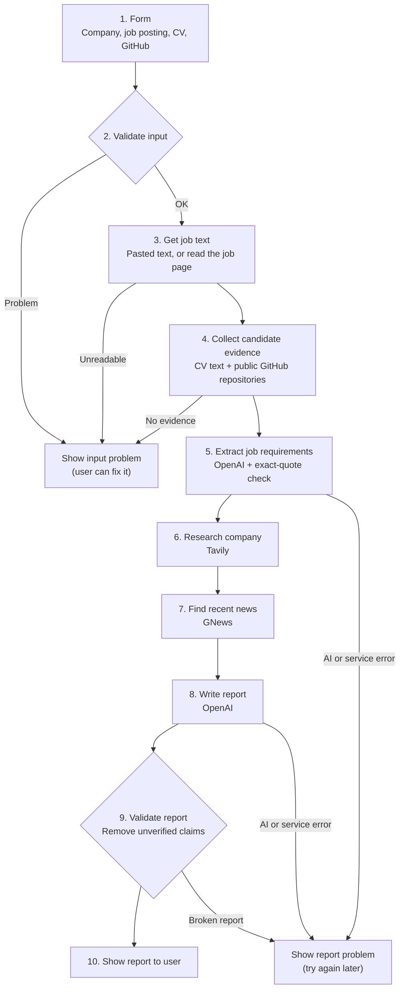

# Interview Prep Report Agent

An n8n workflow that turns a job posting and a candidate's CV into a one-page interview preparation report, with sources for every company fact and evidence for every match.

**Demo video:** [link to recording] *(opens without a login)*
**Author:** Roodabeh Seif · Ironhack AI Consulting, Project 3 · Primary stack: n8n


---

## The problem and the user

**User:** a job seeker with an interview coming up.

**Today:** before an interview, they research the company, read the job ad line by line, and decide which of their own examples to use. This takes hours and is easy to do badly under time pressure.

**With this agent:** they fill in one form, and within about a minute they get a report that tells them what to say about the company, which of their examples match the role, what to prepare, and which questions to expect.

## What goes in, what comes out

**Input (one web form):**

| Field | Required | Notes |
|---|---|---|
| Company name | Yes | Used for company research and news |
| Job posting | Yes | Paste the full text, or a link to the job ad |
| CV as text | No | Pasted CV or LinkedIn experience |
| GitHub profile | No | Username or profile link |
| CV file | No | PDF, `.md`, or `.txt` |

At least one candidate source (CV text, CV file, or GitHub) is required.

**Output: a report with 7 sections**

1. **Company background**, with source links
2. **Recent news**: up to 3 recent items, each with a date, link, and why it matters for the interview
3. **Role requirements**: Must-have and Nice-to-have, taken from the job posting
4. **Your match**: each requirement matched to an exact quote from the CV or a real GitHub repository
5. **Projects to highlight**
6. **Skill gaps**, each with one concrete preparation step
7. **Five likely interview questions**: 2 technical, 1 about the company or news, 1 about the biggest gap, 1 behavioural

The report also includes `removed_claims` (anything the AI wrote that could not be verified) and `data_notes` (sources that were missing).

---

## Architecture

The workflow runs from the form to the report with no human steps in between.



### Steps in plain words

| Step | What happens |
|---|---|
| 1. Form | The user submits the form. This triggers the workflow. |
| 2. Validate input | Checks required fields, text length, file type, and GitHub username. Splits the job field into a link or pasted text. |
| 3. Get job text | If only a link was given, downloads the page and extracts the job ad. Stops if less than 300 characters can be read. |
| 4. Candidate evidence | Reads the PDF CV, adds pasted text, and loads up to 30 public repositories (forks removed). |
| 5. Requirements | A focused AI step extracts up to 8 requirements. Each must quote the job posting exactly, or it is dropped. |
| 6. Company research | Searches the web for the company plus the team or product named in the job ad. |
| 7. News | Gets the 10 newest English articles about the company. |
| 8. Write report | The AI writes the report from the checked data only, following strict matching rules. |
| 9. Validate report | Deterministic code removes every claim it cannot trace to a source. |
| 10. Show report | The report appears in the form window. |

---

## Grounding and quality checks

This MVP does not use a vector database. Instead, every statement is grounded by code checks after the AI writes:

| Check | Rule | If it fails |
|---|---|---|
| Requirements | Must quote the job posting exactly | Dropped |
| Company sources | Links must come from the Tavily results | Removed |
| News | Links must come from the GNews results | Removed |
| Experience matches | Must quote the CV, or point to one of the candidate's repositories | Removed |
| Must-have coverage | Every Must-have requirement is either matched or listed as a gap | Added to skill gaps |

Text comparison ignores punctuation and rejoins words split across lines, so PDF text is checked correctly. See [stack_decision.md](stack_decision.md) for why this approach was chosen over RAG for the MVP.

## Error handling

| Situation | What the user sees |
|---|---|
| Missing or invalid input | "We could not start your report: [reason]. Please go back, fix it, and submit again." |
| Job page cannot be read (e.g. LinkedIn) | Asked to paste the job description instead |
| Company research or news unavailable | The report is still created, with a note about the missing source |
| GitHub unavailable or no repositories | The report uses the CV only, with a note |
| AI or service failure | "Sorry, we could not finish your report. Please try again in a few minutes." |

All API calls retry once before failing.

---

## Tools and APIs

| Tool | Purpose | Free plan used |
|---|---|---|
| [Tavily](https://tavily.com) | Company research with source links | 1,000 credits per month |
| [GNews](https://gnews.io) | Recent company news | 100 requests per day |
| [GitHub REST API](https://docs.github.com/en/rest) | The candidate's public repositories | 60 requests per hour, no key |
| [OpenAI](https://platform.openai.com) (gpt-4o-mini) | Requirement extraction and report writing | Paid per use |

---

## Setup

1. **n8n:** an n8n account (cloud or self-hosted).
2. **API keys:** get keys for OpenAI, Tavily, and GNews. The names are listed in [.env.example](.env.example).
3. **Import the workflow:** in n8n, create a new workflow, then **⋯ → Import from File** and choose `workflow/interview-prep-report.json`.
4. **Create three credentials** in n8n and connect them to the nodes:

| Credential type | Name / value | Used by |
|---|---|---|
| OpenAI | your OpenAI key | Extract Job Requirements, Generate Report |
| Header Auth | Name: `Authorization` · Value: `Bearer <your Tavily key>` | Company Research |
| Query Auth | Name: `apikey` · Value: `<your GNews key>` | Find Recent News |

Keys are stored only in n8n credentials. The exported workflow file contains no keys, and no `.env` file is committed.

## How to run

1. Open the workflow and click **Execute workflow**. The form opens in a new tab.
2. Fill in:
   - **Company name**, for example `n8n`
   - **Job posting**: paste the full job ad text
   - **CV file**: upload `samples/test_cv_maya_keller.md` (a fictional test profile)
3. Click **Submit** and wait about [__] seconds.
4. The report appears in the form window. The full output, including `removed_claims` and `data_notes`, is in the **Validate Report** node.

To share the form with real users, publish the workflow and use the **Production URL** of the form.

---

## File map

```
interview-prep-report-agent/
├── README.md                  This file
├── stack_decision.md          Why n8n, and why LangGraph is secondary
├── gtm_future_sprints.md      Three go-to-market sprints after the MVP
├── .env.example               API key names (no real keys)
├── .gitignore                 Keeps keys and real CVs out of the repo
├── workflow/
│   └── interview-prep-report.json   n8n workflow export (no credentials)
├── samples/
│   ├── test_cv_maya_keller.md       Fictional CV used for testing and the demo
│   ├── report-1-n8n.json            Sample report 1
│   └── report-2-[company].json      Sample report 2
├── screenshots/               Workflow canvas, form, and report
└── presentation/
    └── project3_slides.pdf    Presentation slides
```

## Sample reports

Two reports for two different companies, both created with the fictional test CV:

- [Report 1: n8n, Product Designer](samples/report-1-n8n.json)
- [Report 2: [company], [role]](samples/report-2-[company].json)

No real personal data is stored in this repository.

---

## Known limitations

- **LinkedIn job links** usually cannot be read automatically. In testing, LinkedIn returned only a one-sentence summary. The workflow rejects page text under 300 characters and asks the user to paste the job description. Pasted text or a company careers page works best.
- **GNews free plan:** articles arrive with a 12-hour delay, and only the last 30 days are searched. When a company name is also a product name, results can include product reviews rather than company news.
- **Report display:** the report is currently shown as structured text in the form, not as a formatted page.
- **Soft skills:** the requirement extraction sometimes still includes soft skills, even though the prompt asks it not to.

## Next steps

- Format the report as a readable one-page document.
- Improve requirement extraction and matching quality, measured on a fixed set of test job postings.
- Go-to-market: see [gtm_future_sprints.md](gtm_future_sprints.md).
